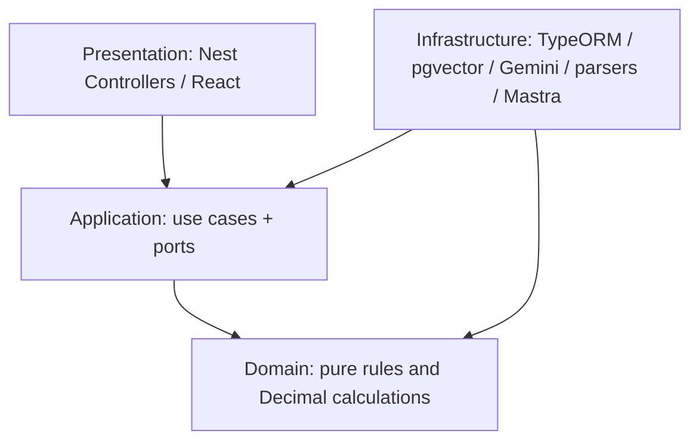

# مراجعة اليوم الأول

تحديث التحقق الفعلي: GitHub وGemini جاهزين. تحميل7 سياسات/87chunk نجح وإعادة التحميل تخطتها كلها. Live smoke: سؤالا DBR صحيحان، سؤالا خارج النطاق رُفضا، وسؤال مدة72 شهرًا رُفض خطأ رغم استرجاع البند. التفاصيل في docs/LIVE-SMOKE-2026-11-17.md. أي ذكر لاحق لانتظار credentials هو وصف الإعداد الأول؛ العائق الحالي جودة حالة المدة وباقي بنود اليوم الأول.

اقرأ الملف ده أولًا. الهدف من اليوم الأول: تجهيز المشروع، قراءة المستندات، التخزين، الحسابات، والبحث الدلالي مع المصادر. الـUI الكاملة وتقييم الطلب والموافقة البشرية ضمن اليوم الثاني؛ يوجد عمل مبكر جزئي لها، وليست مكتملة.

## 1 ما اتبنى

للمراجعة السريعة: شغّل أوامر القسم2، واقرأ رسم القسم5. باقي الأقسام تفاصيل تجربة اختيارية. **اليوم الأول لسه له بنود مفتوحة موضحة في القسم7، فلا تعتبر هذا تسليمًا مكتملًا لكل P01–P05.**

| الجزء | النتيجة القابلة للمراجعة |
|---|---|
| Foundation | Node/TypeScript، Nest، React shell، dependencies ثابتة، Jest، lint/types/build، Git branches وCI YAML |
| PostgreSQL | Docker + pgvector، migrations صريحة، schemas منفصلة knowledge وcases |
| Parsers | PDF/CSV/MD فقط، validation، normalization، صفحة/قسم/صف CSV، قراءة الـ12 ملف الأصلي |
| Ingestion | manifest موثوق للسياسات السبع؛ embedding ثم حفظ ذري؛ إعادة التحميل لا تكرر البيانات؛ ملفات العملاء ممنوعة من policy KB |
| Calculations | Decimal EMI/DBR/max principal، اختيار policy بتاريخ الطلب، rates من CSV، eligibility rules |
| Vector Q&A | pgvector cosine مع date/product/model filters؛ top5؛ threshold؛ citations متحققة؛ refusal؛ أوامر seed/ask |

إجابات Q&A الحالية تعرض اقتباسات المصدر حرفيًا بعد تحقق الكود. ده baseline محافظ؛ صياغة شرح حر وحساب الأسئلة بلغة طبيعية لسه مش مكتملين. الحسابات متاحة ومختبرة في محرك الـDomain. الـthreshold الحالي 0.65 إعداد مبدئي لم تتم معايرته على مزود حقيقي.

## 2 جرّب بنفسك من PowerShell

افتح terminal داخل `G:\Credit Copilot`. تحتاج Node24 وpnpm11.25.0 وDocker Desktop.

```powershell
pnpm install --frozen-lockfile
docker compose up -d db
Copy-Item .env.example .env
```

انسخ ملف الإعداد مرة واحدة فقط؛ لو `.env` موجود متستبدلوش. افتحه محليًا وأضف Gemini key بدون مشاركته في الشات. Strict هو الافتراضي. اترك ALLOW_DEMO_MODE=false لمراجعة اليوم الأول.

```powershell
pnpm db:migrate
pnpm db:migrate
```

الأول ينشئ schema لو جديدة، والثاني المفروض يطبع Applied0 migrations. مفيش synchronize أو إنشاء جداول من الـstartup.

```powershell
pnpm test
pnpm typecheck
pnpm lint
pnpm format:check
pnpm build
```

الاختبارات دي لا تحتاج API key. ابحث عن PASS، وأي فشل ظاهر لا تتجاهله.

## 3 اختبار قاعدة البيانات الحقيقي

الاختبارات تستخدم قاعدة منفصلة اسمها ينتهي بـ_test، وتفرغ بيانات اختبارها فقط. أول مرة أنشئها:

```powershell
docker compose exec -T db psql -U copilot -d postgres -c "CREATE DATABASE credit_copilot_test"
pnpm test:integration
```

لو القاعدة موجودة أصلًا، تخطَّ أمر CREATE. الاختبارات تثبت عدم التكرار، rollback لفشل embedding، منع APP من دخول policy KB، filtering بالإصدار، وحفظ التقييم/audit بدون overwrite.

## 4 تجربة Gemini والبحث الفعلي

بعد إضافة المفتاح محليًا:

```powershell
pnpm seed
pnpm seed
pnpm ask "What is the maximum debt burden ratio?" "2025-04-03"
pnpm ask "What is the maximum debt burden ratio?" "2024-12-01"
pnpm ask "Can PL-100 be offered for 72 months?" "2025-04-03"
pnpm ask "What is the policy for crypto-backed loans?" "2025-04-03"
```

المتوقع: التحميل الأول succeeded والثاني skipped. سؤال2025 يستند لحد45%، وسؤال2024 لحد50%. المدة60 للمنتج رغم سقف الجهة الرقابية72، والمصادر لازم تشرح القيدين. سؤال crypto لازم يرفض. **دي نتائج متوقعة للمراجعة، وليست نتائج live مُقاسة حتى الآن.** لو النتيجة مختلفة سجّلها؛ لا تغيّر الـexpected answer لإخفاء الفشل.

كل citation فيها الملف والقسم/الصفحة والإصدار وchunkId. الملفات الخمسة APP مش جزء من إجابات السياسة. لا يوجد أمر CLI تفاعلي كامل للاعتماد بعد؛ React UI ضمن اليوم الثاني.

## 5 افهم الـarchitecture في دقيقة



السهم هنا اعتماد كود. الـDomain لا يستورد DB أو LLM. الـApplication يحدد الواجهات، والـInfrastructure ينفذها. نقطة ربط dependencies تكون في Nest أو scripts.

اقرأ بالترتيب لو حابب تشوف الكود:

1. `packages/domain/src/calculations.ts`: الأرقام.
2. `packages/domain/src/policy.ts`: اختيار الإصدار والتسعير.
3. `packages/application/src/questions.ts`: retrieval port → sources → verification/refusal.
4. `packages/infrastructure/src/parsers/registry.ts`: اختيار parser والتحقق من الملف.
5. `packages/infrastructure/src/knowledge/ingestion.ts`: عدم التكرار والحفظ الذري.
6. `packages/infrastructure/src/knowledge/retrieval.ts`: SQL pgvector المفلتر.
7. `packages/infrastructure/src/db/assessment-repository.ts`: مثال فصل التخزين عن use case.

## 6 راجع الحساب المتعارض

في `tests/calculations.test.ts`: نفس دخل30,000 والتزامات4,000 وrate24% و60 شهرًا:

- EMI لطلب300,000 =8,630.39.
- CP-2024 / DBR50% => maximum382,000.
- CP-2025 / DBR45% => maximum330,000.

الأرقام ناتج معادلة، وليست hardcoded في المحرك. Appendix E متعارض وتم توثيقه في DESIGN وEVALUATION.

تقدر تختبر الحساب من غير DB أو API key. الأمر يقرأ `data/config/calculation-example.json`؛ غيّر التاريخ لاختبار إصدار2024 أو مرر مسار JSON آخر:

```powershell
pnpm calculate
```

الناتج حساب affordability فقط وليس قرار أهلية أو عرضًا معتمدًا.

## 7 حدود تسليم اليوم الأول

الفحوصات المحلية منفصلة عن جودة النموذج الحقيقية. لسه محتاجين مفتاح محلي لإجراء smoke/calibration/baseline live، وتسجيل دخول GitHub لرفع الفروع وفتح R1 PR ومشاهدة Actions خضراء. لا يوجد نشر تلقائي.

أجزاء من P03/P05 تحتاج إكمال قبل وصف اليوم الأول بأنه مقفول بالكامل: token-aware chunk limits/overlap، versioned revision replacement مع الاحتفاظ بالاقتباسات القديمة، numeric Q&A routing، قياس baseline الحقيقي وشرح تعارض المصادر بشكل مضمون. النموذج لا يُسمح له بإجراء الحسابات. ملفات scan/encryption لها معالجة أخطاء، لكن اختبارات fixtures مخصصة لها لسه مطلوبة. الواجهة حاليًا shell فقط ولم تمر browser QA؛ ما تعتبرهاش UI مكتملة.

حالة التنفيذ المختصرة ومكان الاستكمال دائمًا في `status.md`. تجنب التعامل مع ملف الخطة أو قوائم اختبارات مقترحة كأنها دليل تنفيذ.
