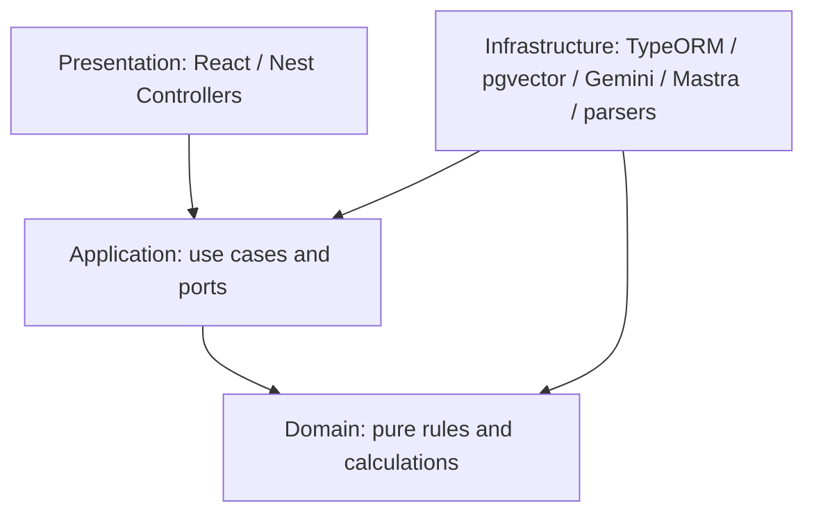

# Credit Copilot

## REST API — آخر تسليم

الـREST الأساسي جاهز، وواجهة React الكاملة هي الخطوة التالية. شغّل migrations قبل الـAPI. كل المسارات التالية تحت `/api/v1` وتحتاج جلسة دخول، ومع POST أرسل cookie و`x-csrf-token`:

| المسار | الاستخدام |
|---|---|
| `GET /knowledge/documents` | عرض السياسات المفهرسة |
| `POST /knowledge/ingestions` | multipart بحقل `files`؛ من1 إلى20 ملفًا؛ صلاحية ingestion مطلوبة |
| `GET /knowledge/ingestions` | نتائج المحاولات لمن يملك صلاحية ingestion |
| `POST /questions` | JSON مثل `{"question":"Maximum DBR in CP-2024?"}`؛ يقبل `asOfDate` و`edition` و`product: "PL-100"` |
| `POST /calculations` | نفس JSON الخاص بـcalculate: principal/income/obligations/months/date |
| `GET /applications/fixtures` | قائمة APP-001 إلى APP-005 |
| `POST /applications/fixtures/APP-001` | اختيار pack معروف بجسم `{}` |
| `POST /applications` | رفع pack أصلي multipart بحقل `file` |
| `GET /applications` أو `/applications/:id` | قائمة الطلبات أو بيانات الطلب المسموحة |
| `GET /applications/:id/evidence` | تنزيل الملف الأصلي لصاحب الطلب أو المراجع |
| `POST /applications/:id/assessments` | `{}` لـStrict أو `{"mode":"demo"}` عند تفعيل ALLOW_DEMO_MODE محليًا |
| `GET /offers/:id` | قراءة سجل العرض الصادر مع علامة Demo والتحقق الفعلي |

الرفع يقبل الأنواع PDF/CSV/MD وحد10MiB، لكن Knowledge Base تقبل السياسات السبع المطابقة للـmanifest فقط، وتقييم العملاء يقبل الـPDF packs الخمسة المعروفة بالـhash فقط. لا يوجد رفع عام لبيانات عملاء حقيقية. نتائج دفعة ingestion لكل ملف على حدة؛ راجع `results` لأن فشل ملف لا يلغي نجاح الباقي. المستخدم وكون الطلب synthetic يُحددان على السيرفر، وأي flags إضافية تُرفض.

عند التقييم أرسل `Idempotency-Key` ثابتًا لنفس المحاولة: إعادة الطلب بعد النجاح ترجع نفس run؛ المفتاح نفسه مع mode مختلف يرفض409، والمحاولة الفاشلة تحتاج مفتاحًا جديدًا. يمنع تشغيل تقييمين لنفس الطلب، وأي قرار على نتيجة سابقة أثناء إعادة التقييم. المحاولات العالقة أكثر من15 دقيقة تُغلق عند بدء محاولة جديدة؛ نتيجتها المتأخرة لا تستبدل النتيجة الجديدة. الطلب الصادر عرضه لا يعاد تقييمه. السؤال يستنتج تاريخ ISO أو إصدار CP المذكور صراحة، ويستخدم تاريخ القاهرة الحالي إن لم تحدده؛ تعارض التاريخ والإصدار يرفض بدل اختيار سياسة بصمت.

آخر تحقق لهذا التسليم:77 unit و23 PostgreSQL/HTTP integration، مع types/lint/format/build. اختبارات HTTP تستخدم provider وهميًا؛ لا تعتبر قياسًا جديدًا لجودة Gemini. نتائج Gemini الحقيقية السابقة محفوظة في `docs/EVALUATION.md`.

## تسجيل الدخول والاعتماد

ضع `DEMO_PASSWORD` محليًا في `.env` بطول12–256 حرفًا، ثم:

```powershell
pnpm db:migrate
pnpm seed:users
pnpm dev:api
```

الحسابات: `loan-officer` للإعداد، `credit-officer` بحد250,000، `senior-credit-officer` بحد500,000، و`head-credit` بحد1,000,000. كلهم يستخدمون كلمة المرور المحلية المحددة للـdemo فقط. إعادة seed تحدث كلمة المرور وتلغي جلساتهم. الحسابات التي ينشئها CLI للتقييم معطّلة عن تسجيل الدخول.

التوثيق: `http://localhost:3000/api/docs` (استخدم PORT بديلًا لو مشغول). Login يرجع cookie من نوع HttpOnly و`csrfToken`؛ أرسل الكوكي ومعه `x-csrf-token` في أي طلب تغيير حالة:

- `POST /api/v1/auth/login` ببيانات username/password فقط؛ `GET /auth/me` و`POST /auth/logout` تحت نفس prefix.
- `GET /api/v1/reviews` للمراجعين، و`GET /api/v1/assessments/:id` لصاحب الطلب أو Credit Officer.
- `POST /api/v1/assessments/:id/decisions` ببيانات `action` و`expectedVersion` و`comment`. Actions: `approve`، `reject` (يحتاج clause)، `customer_response` (يحتاج accepted)، `issue` (يحتاج disbursementDate).

الحد يُحسب على المبلغ المقترح، ولا يجوز اعتماد الطلب بواسطة معدّه. قبول البديل لازم يتسجل بواسطة معدّ الطلب قبل الاعتماد. الإصدار خطوة منفصلة بعد الموافقة وتعيد فحص سن الاستحقاق. Demo يصدر سجل عرض محاكاة بعلامة Demo وافتراضاته؛ ليس إثباتًا لاكتمال المستندات أو PDF جاهزًا. أي إحالة ناقصة/متلاعب بها تحتاج أدلة وإعادة تقييم؛ صلاحية Senior لا تتجاوز المتطلبات تلقائيًا. الـREST الأساسي جاهز، وواجهة React الكاملة لاحقًا.

Synthetic personal-loan underwriting assistant. Implementation is in progress;
the detailed scope and delivery sequence live in `docs/PR-PLAN.md`.


## التشغيل والمراجعة

آخر تحديث:17 نوفمبر2026. نطاق اليوم الأول P01–P05. يوجد عمل مبكر جزئي للـassessment، لكنه ليس تسليم اليوم الثاني.

## اللي هتراجعه

- هيكل React + NestJS + TypeScript، dependencies ثابتة وCI.
- PostgreSQL + pgvector، migrations، وفصل policy knowledge عن customer evidence.
- PDF/CSV/MD parsers وnormalization وclause chunking: حد800token وoverlap60 باستخدام cl100k_base.
- ingestion للسياسات السبع فقط، بدون تكرار، مع index revisions تحتفظ بالـchunks القديمة.
- محرك حسابات Decimal واختيار السياسة والتسعير من المصادر.
- vector search + citations متحققة + refusal، وأمر حساب structured بدون LLM arithmetic.

## اختبر بنفسك

من Terminal داخل G:\Credit Copilot:

```powershell
pnpm install --frozen-lockfile
docker compose up -d db
pnpm db:migrate
pnpm test
pnpm typecheck
pnpm lint
pnpm format:check
pnpm build
pnpm calculate
pnpm evaluate:offline
```

الإعدادات موجودة في .env؛ لا تنشره. Strict افتراضي. calculate يقرأ data/config/calculation-example.json؛ غيّر التاريخ من2025-04-03 إلى2024-12-01 لمقارنة الإصدارين.

المتوقع: EMI8630.39، maximum330000 لسياسة2025 أو382000 لسياسة2024. الناتج affordability فقط، وليس موافقة أو عرض قرض.

## جرّب البحث الحقيقي

```powershell
pnpm seed
pnpm seed
pnpm ask "What is the maximum debt burden ratio?" "2025-04-03"
pnpm ask "What is the maximum debt burden ratio?" "2024-12-01"
pnpm ask "Can PL-100 be offered for 72 months?" "2025-04-03"
pnpm ask "What is the policy for crypto-backed loans?" "2025-04-03"
pnpm evaluate
```

seed الثاني يرجع skipped. DBR45% في2025 و50% في2024، والمنتج يظل60 شهرًا، وcrypto refusal. evaluate الحالي خمس حالات live فقط، وليس تقييم FR-6 الكامل المطلوب في اليوم الثاني. الطلبات تستهلك quota من حساب Gemini.

نتائج اليوم الأول التاريخية:62 unit tests و5 PostgreSQL integration tests ناجحين؛ العدد الحالي أعلى كما هو موضح في آخر تسليم أعلاه. القياس الحقيقي بعد الإصلاح: hit@5 =3/3 للأسئلة القابلة للإجابة؛ refusal correctness =5/5؛ out-of-corpus refusal =2/2. الحالة الأولى لسؤال المدة فشلت وتم الاحتفاظ بها في docs/EVALUATION.md، ثم أصلحنا اختلاف اسم حقل JSON وأعدنا القياس بنجاح.

## اختبارات قاعدة البيانات

قاعدة الاختبار منفصلة وتنتهي بـ_test. إن لم تكن موجودة أنشئها مرة واحدة:

```powershell
docker compose exec -T db psql -U copilot -d postgres -c "CREATE DATABASE credit_copilot_test"
pnpm test:integration
```

الاختبارات تفرغ قاعدة الاختبار فقط. تثبت idempotency وfailure rollback وhistorical citation retention وpolicy/evidence isolation.

## افهم الـarchitecture



الأسهم اعتماد كود: الـDomain لا يستورد DB أو LLM. Application يحدد واجهات الخدمات، Infrastructure ينفذها. scripts وNest composition root يربطوا المكونات.

اقرأ بالترتيب:
1. packages/domain/src/calculations.ts
2. packages/domain/src/policy.ts
3. packages/application/src/questions.ts
4. packages/application/src/calculation-question.ts
5. packages/infrastructure/src/parsers/registry.ts
6. packages/infrastructure/src/knowledge/ingestion.ts
7. packages/infrastructure/src/knowledge/retrieval.ts

## حدود واضحة

## تجربة تقييم الطلب

بعد تشغيل PostgreSQL و`pnpm db:migrate` و`pnpm seed`:

```powershell
pnpm assess APP-001
```

Strict افتراضي: كل الـpacks الأصلية ناقصها نسخة البطاقة، فبتتحول لمراجعة بشرية. لتجربة Demo صراحة في نفس الـterminal فقط:

```powershell
$env:ALLOW_DEMO_MODE='true'
pnpm assess APP-001 --demo
pnpm assess APP-004 --demo
Remove-Item Env:ALLOW_DEMO_MODE
```

APP-001 يرجع توصية pending_approval؛ APP-004 إحالة احتيال بدون LLM. Demo يفترض وجود البطاقة فقط ويحتفظ بـverified=false. APP-002/003/005 عندها نقص إثبات probation فبتتحول لمراجعة بشرية حتى في Demo؛ لا نفترض اكتماله لعرض نتيجة مرغوبة. كل تشغيل يحفظ طلب synthetic منفصلًا و8 أحداث مراحل والنتيجة والافتراضات وبنود السياسة وتوكنات الاستدعاء المتاحة. الـCLI مخصص للـfixtures المحلية بحساب disabled لا يصلح لتسجيل الدخول؛ ليس endpoint عام أو نظام اعتماد. التقييم متاح عبر REST محمية بالمصادقة كما هو موضح أعلاه؛ واجهة React الكاملة هي العمل التالي.

Q&A تعرض اقتباسات المصدر؛ لا توجد صياغة شرح حر مضمونة أو استخراج محادثي عام للأرقام. استخدم JSON مع calculate للحساب. threshold0.65 مبدئي؛ خمس حالات لا تثبت الجودة العامة. cl100k ليس tokenizer Gemini. نفس document/version ببايتات مختلفة يرفض؛ التحديث المسموح بإصدار pipeline يحفظ التاريخ. واجهة React حاليًا shell؛ full UI/full15-case evaluation/stretches لاحقًا. تمت إضافة fixtures لـPDF بلا نص وPDF محمي وكمان اختبار ملف تالف؛ كلها تُرفض بأخطاء واضحة.

تابع PRs وActions على GitHub؛ status.md يسجل الحالة الفعلية وآخر خطوة، ولا تعتبر وجود CI YAML دليلًا أن كل run نجح.


لو المنفذ3000 مشغول، شغّل الـAPI بـ`$env:PORT="4300"; pnpm dev:api`، وفي terminal آخر شغّل الويب بـ`$env:API_PROXY_TARGET="http://127.0.0.1:4300"; pnpm dev:web`. الـUI حاليًا connectivity shell فقط.
