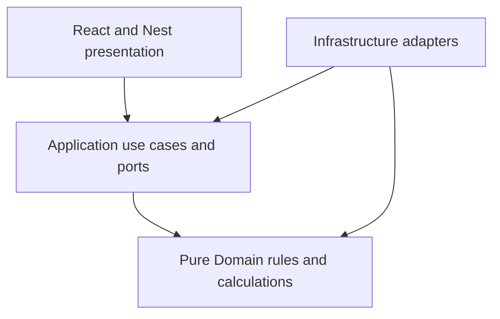

# Credit Copilot design

## Sessions and human decisions

Application defines AuthStore/Credentials/DecisionStore ports. Infrastructure uses
scrypt password hashes,32-byte random sessions (only SHA256 token hashes in DB),
expiry/revocation/active-user checks and atomic per-IP login throttling. Transport
uses HttpOnly SameSite Strict cookies, optional Secure for HTTPS, CSRF headers and
an origin allowlist. Body schemas reject client role/tier/amount/approver overrides;
server roles are reread inside decision transactions. No public user registration
or role-upgrade endpoint exists. Local seed accounts are synthetic demo tooling.

Approval requires a different preparer/reviewer, positive recommended amount within
the server authority tier, complete resolved assessment and recorded acceptance
for alternatives. Missing/tampered referrals cannot be waived; corrected evidence
requires reassessment. Rejection cites a failed/missing clause, or CP-4.1 after
the customer rejects an alternative. State transitions lock application/run rows
and check expectedVersion plus latest assessment pointer. The original assessment
snapshot stays immutable; status/version, decisions and audit are separate records.
Issuance requires stored approval, tier check and source-policy maturity recheck;
unique constraints prevent double decisions/offers. Demo flags propagate to offers.
Full authenticated ingestion/assessment transport and React remain subsequent work.

## Document assessment workflow

The supported fixture entry point is scripts/assess.ts and the eight-stage Mastra
adapter packages/infrastructure/src/workflows/document-assessment.ts. Application
stages live in packages/application/src/document-assessment.ts: local form schema,
protected-field stripping/local evidence facts, policy selection, verified model
extraction, exact required-clause retrieval, pure rules, canonical memo, pending
review persistence. The new input rejects client evidence/verifiedFacts properties.
No Mastra snapshot storage is configured; originals stay in the private case store.

The local CLI derives non-model facts from supported English evidence layouts;
unknown purpose, missing certificate/default evidence or contradictory employers
refer. Permanent employment alone does not prove probation completion. Required
policy clauses are loaded by edition/product/date from the active reviewed index;
missing clauses or DBR-source/config drift refer. Records include retrieved IDs,
executed/skipped/failed stage events, and provider usage even when returned JSON
later fails validation. Usage unavailable on transport failures remains unknown.
Saving failure fails the run rather than reporting success. No approval/offer is
issued. Internal legacy assessment helpers remain test harnesses; public transport
must use the document workflow and derive identity/synthetic status server-side.

## Versioned policy index

Clause chunking uses pinned cl100k_base tokenization (js-tiktoken1.0.21),800-token
maximum and60-token overlap only within oversized clauses. Small clauses/tables
stay intact. This tokenizer is a documented chunking budget, not Gemini usage.
Index migrations preserve legacy chunks and revision snapshots; a successful
transaction activates the new pipeline's chunks and deactivates previous ones.
Failures leave the old active index intact. Historical chunk IDs remain stored
for earlier citations. Changing bytes under the same reviewed document version
is rejected rather than silently replacing source evidence.

Numeric questions use a strict structured input contract through `pnpm calculate`.
The code chooses source-backed policy/pricing and returns calculation citations;
caller-supplied rates/DBR thresholds are rejected. Conversational number/date
extraction is not part of this baseline. Q&A returns exact source spans; the
explicit `text` alias accommodates observed provider JSON without trusting prose.

Implementation is incremental; README and status.md distinguish completed behavior from future work.

## Source-authoritative arithmetic

The pure decimal calculation engine receives thresholds from versioned policy configuration.
CP-2024 CP-4.1 sets maximum DBR50%; CP-2025 CP-4.1 sets45%. With net income30,000,
obligations4,000, annual rate24% and60 months, the inverse annuity formula yields
382,369.7534… at50% and330,228.4234… at45%. Floor to EGP1,000 gives382,000 and330,000.
Appendix E incorrectly labels the case CP-2025 while retaining382,000 from the50% example.
The engine does not special-case the example or modify the formula to match Appendix E.
Tests cover both editions using the same function. EMI rounds half-up to cents; DBR
is compared using the exact numerator against income multiplied by policy limit,
not the displayed rounded percentage. Policy configuration is reviewed source-backed
data, never a request-level override. Pricing must come from parsed CSV rows.

## Evidence modes

Configuration defaults to ASSESSMENT_MODE=strict and ALLOW_DEMO_MODE=false. Missing
national ID copy in Strict mode produces REFER_TO_HUMAN/MISSING_REQUIRED_EVIDENCE,
citing CP-8 and PS-7. Explicit enabled Demo is restricted to synthetic cases and can
assume only ID-copy presence. The result and audit events record the assumption,
actual missing evidence, actor/time and verified=false. No document is fabricated.
Other missing evidence, including probation confirmation, still requires referral.
Demo assessments are never presented as fully evidence-verified; changes of mode
require a new assessment, not relabeling an earlier result.

## Domain isolation

Authenticated REST uses OperationsService application ports, composed by Nest's
main entry point with existing parsers, knowledge services, calculation functions
and the eight-stage Mastra workflow. Controllers validate transport shape and
session/CSRF; the server derives actor identity and reviewed synthetic status.
Only byte hashes of the five supplied packs are accepted for customer uploads;
only the seven reviewed manifest documents enter policy knowledge. Original pack
bytes stay in cases.evidence_documents with owner/reviewer-only downloads. Safe
application reads omit personal identifiers and protected fields. Q&A masks IDs
and Egyptian phones before both embedding and generation. Explicit date/edition
selectors must agree with dates/editions in the question; otherwise fail closed.

Assessment jobs reserve one active run per application under an application lock.
Idempotency keys bind the application and mode; success replays the immutable
result, concurrent attempts return409, failures require a new key. Job completion,
snapshot, latest pointer and audit events commit together. A new attempt can expire
jobs older than15 minutes; expired jobs cannot persist late results. Decisions
share the application lock and reject while a reassessment is running; the review
queue omits superseded runs. Issued applications cannot start another assessment.
The15-minute lease is fixed for now, not a background queue or resumable worker.

Application defines assessment, authentication and decision repository ports;
Infrastructure implements PostgreSQL transactions. Assessment snapshots are insert-only,
while explicit decisions update lifecycle status/version and append audit records.
The latest-assessment pointer is updated under the same application lock as saving
new runs, preventing an older run from being approved after reassessment. New entry
points use the eight-stage document workflow; legacy wrappers are test harnesses.

Pure domain functions have no database, network, NestJS, Mastra or model imports.
ESLint enforces the infrastructure boundary. Dates use UTC calendar-only values and
month-end clamping; maturity is compared with the60th birthday. Strict configuration
validation prevents the string "false" from being treated as a true boolean.

## Architecture and source constraints

PostgreSQL knowledge/cases schemas and repositories separate trusted policy from
untrusted customer evidence. PDF/CSV/MD only, maximum10MiB/file and100 PDF pages;
no OCR. Clause/page/CSV-row provenance is retained; trusted source hashes live in
data/config/corpus-manifest.json. Documents at data/corpus are authoritative.
Provider prompts are files; Application generation/embed interfaces isolate Gemini.
A new provider implements ports in packages/infrastructure/src/llm and is selected
at the composition root (scripts/runtime.ts and apps/api/src/main.ts).

Application date selects half-open policy intervals; missing/ambiguous coverage
refers. CP2025 income10,000 overrides product's old8,000; PL-100 remains20,000–1m
and12–60 months despite circular72. Bureau score below600 refers, defaults decline,
verified hard eligibility failures decline; affordability follows eligibility.
Age at final maturity uses calendar dates, maximum60th birthday; minimum age21,
employment6 completed months, stamped salary evidence within60 days. Include all
bureau obligations/card minima; variable annual commission is not monthly salary.
Fees: admin1% deducted at disbursement, early settlement2% outstanding, late150EGP;
do not add them to regular principal/DBR without an applicable source rule.

Protected fields are removed locally before model/rules; model sees allowlisted
salary/bureau lines, not form names/IDs/phones. Verify labeled quotes and values,
not merely a number occurring somewhere. Tampering requires fraud referral. Human
approval must enforce authority0/250k/500k/1m and different preparer/approver; referred
approval requires Senior and written justification, exceptions Head approval, and
pricing deviations Credit Committee authorization. Records retained7 years; written
rejection reasons cite clause/edition and complaint requests have30-day window.
Historical pre-March2025 operational procedures are not supplied; do not invent them.

Remaining scope: React UI, complaints completion, full
15-case evaluation, then all nine stretches (hybrid BM25+pgvector/RRF, rewriting,
new synthetic documents, typed agents, SSE, local fallback, second product, offer
PDF/schedule, per-user usage/cost). PostgreSQL ts_rank is not BM25. Before hybrid,
retain vector baseline; compare actual results without assuming improvement.
