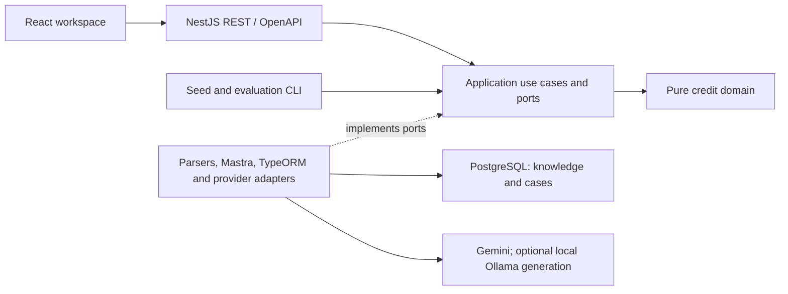

# Credit Copilot design

## Architecture

The application layer orchestrates evidence, policy lookup and decisions. The
domain owns eligibility and exact arithmetic, with no framework, model or
database dependencies. ESLint enforces the boundary. Infrastructure implements
the ports, and controllers enforce session and authority checks. Explicit
TypeORM migrations create the database schema. The local launcher starts
Compose, migrates the schema and starts the API and web app. [Run instructions](../README.md)

The ITI exercise supplied seven policy sources and five personal-loan packs.
The repository adds four authored AL-200 policy sources and three authored
auto-loan packs. The trusted sources are verified by SHA-256 against the policy
manifest. Application packs have their own manifest and stay in the private
case store. [Policy manifest](../data/config/corpus-manifest.json) · [Case manifest](../data/config/assessment-fixtures.json)

## Ingestion and cited retrieval

The parser validates type, size and content for PDF, CSV and Markdown. PDF input
is limited to 100 pages and needs a usable text layer. Normalization retains
section, page and CSV row references. Chunks follow clause, page and row
boundaries so the enclosing source can be cited. Oversized spans split at 800
`cl100k_base` tokens with 60-token overlap to preserve nearby text across the
split. Ingestion is atomic per file and idempotent. New revisions preserve old
chunks for previously recorded citations. [Chunker](../packages/infrastructure/src/parsers/chunker.ts)

The default hybrid search combines PostgreSQL BM25 (`k1=1.2`, `b=0.75`) and
pgvector cosine search over the same active revisions, product, half-open
effective dates, embedding model and dimensions. Each contributes up to 20
candidates to reciprocal rank fusion (`k=60`), which returns five. Q&A still
requires a qualifying cosine score, 0.65 by default. The glossary rewrite adds
up to two equivalent lexical phrases by default. The original masked question
drives the embedding and answer prompt, and eligible original results keep their
places. `QUERY_REWRITE_MAX_EXPANSIONS=0` disables expansion.
`RETRIEVAL_STRATEGY=vector` enables the historical baseline strategy.

The model chooses quoted spans from supplied candidates. The verifier validates
their IDs and wording against the stored source. After a qualifying result, a
separate lookup can supply dated governing and precedence clauses for a complete
citation set. Weak evidence, invalid quotes or a model refusal return a refusal.
Approval-bypass questions with qualifying procedure evidence receive an
explicit rejection and applicable procedure citations. Those questions remain
read-only. [Q&A implementation](../packages/application/src/questions.ts)

## Dated policy and code-only calculations

The application’s date and product select a unique policy and applicable price
row. A policy question can specify an edition or date, with the current Cairo
date as its default. Explicit edition/date references must agree. CP-2024
sets a 50% DBR ceiling and EGP 8,000 minimum net income. CP-2025 applies from
1 March 2025 and sets 45% and EGP 10,000. CP-14 and PS-3 keep PL-100 at its
60-month product limit when the circular allows 72 months conditionally.
The latest applicable rate comes from the dated CSV by tenor and payroll
segment. Missing, conflicting or unsupported source data triggers review.

The domain uses Decimal arithmetic at 50-digit precision. It rounds monthly
instalments to cents, tests DBR before display rounding and floors capacity to
EGP 1,000. At EGP 30,000 net income, EGP 4,000 debt, 24% interest and 60 months,
the monthly instalment on EGP 300,000 is EGP 8,630.39. Maximum capacity is
EGP 382,000 under CP-2024 and EGP 330,000 under CP-2025. Appendix E pairs the
50% capacity with the CP-2025 label. The applicable source governs the result.
The AL-200 extension separately enforces a documented vehicle quote and at
least 25% down. Its financing cap is the lowest of affordability, the product
ceiling and 75% of the vehicle price. The model extracts evidence and selects
quotes. Code evaluates rules, computes every number and fills the memo.
[Calculations](../packages/domain/src/calculations.ts) · [Personal-loan policy](../data/config/policies.json) · [Auto product](../data/config/auto-loan.json)

## Assessment, privacy and accountability

Mastra loads the form, removes protected fields, selects policy, verifies
extraction, loads clauses, evaluates the case, prepares the memo and persists
pending-review state. Optional agent orchestration exposes three bounded tools
for extraction, policy and memo. Code binds the sanitized arguments and
validates each plan. An AI planner cannot change the case or grant approval.

Gender, religion, marital status and nationality stay out of model and rule
inputs. The extraction model receives an allowlisted reference and only net
income, monthly obligations, employment start and bureau score, with source
section and page. Each value must match its labeled source evidence. Policy
questions mask Egyptian national IDs and phone numbers before provider calls.
The fairness comparison changes only protected fields and checks equal hashes
of sanitized provider inputs, rule outcomes, calculations, recommendations and
the canonical memo. APP-004’s injected EGP 200,000 instruction cannot replace
the documented EGP 18,000. The tampering path records an internal fraud referral
and skips extraction and rules. [Verified extraction](../packages/application/src/extraction.ts) · [Evaluation](EVALUATION.md)

Strict is the default. The original packs lack a national ID copy, so Strict
refers under CP-8 and PS-7. Explicit opt-in Demo for synthetic cases assumes
ID-copy presence only. The result, audit and offer record the actual gap and
unverified status. Employment alone cannot establish completed probation. A
bureau score below 600 refers. Code records request and actor IDs, workflow
statuses, policy and chunk IDs, removed-field names and observed model usage.
Reported tokens and nominal Gemini prices give estimates. Missing counters and
unknown Gemini billing tiers stay visible.

Only a separate authorized reviewer can approve. Loan Officers prepare cases.
Credit, Senior and Head reviewers have limits of EGP 250,000, 500,000 and
1,000,000. Issuance rechecks maturity and freezes the approved amount, dated
rate, conditions and actors. The PDF uses that snapshot and a cent-reconciled
repayment schedule. Senior and Head reviewers handle referrals. Written PM-9
reason requests use 30 calendar days inclusive from the recorded Cairo rejection
date, since the sources supply no separate notification timestamp. Signed-in
streams share the same checks, and Q&A streams only send verified citations.

## Switching providers

Add `packages/infrastructure/src/llm/<provider>.ts` and implement
`EmbeddingPort` and `GenerationPort`. Select the adapter in `createProvider`
and add its `LLM_PROVIDER` value and required settings to the config schema
and `.env.example`. Domain rules and workflow stages stay the same. Configure
the generation and embedding models and dimensions. Reindex trusted sources
when the embedding model or dimensions change. The included Ollama adapter
handles opt-in generation fallback on transient failures. Gemini supplies
embeddings in that mode. [Provider ports](../packages/application/src/ports.ts) · [Factory](../packages/infrastructure/src/llm/provider.ts) · [Configuration](../packages/contracts/src/config.ts)

## Intentional scope and follow-up

The interface and code-filled memo use plain language. Ingestion covers
reviewed text documents. Fraud routing stays in the application, and issuance
produces a simulated offer. External case processing, OCR and production
deployment are outside this exercise. With more time, I would first expand
the dated policy and out-of-corpus benchmark, add cross-browser and
recovery tests, and exercise additional provider outages. The four
answerable retrieval examples and offline provider fixtures limit how far
the reported quality scores generalize. [Evaluation](EVALUATION.md) · [Verification status](../status.md)
