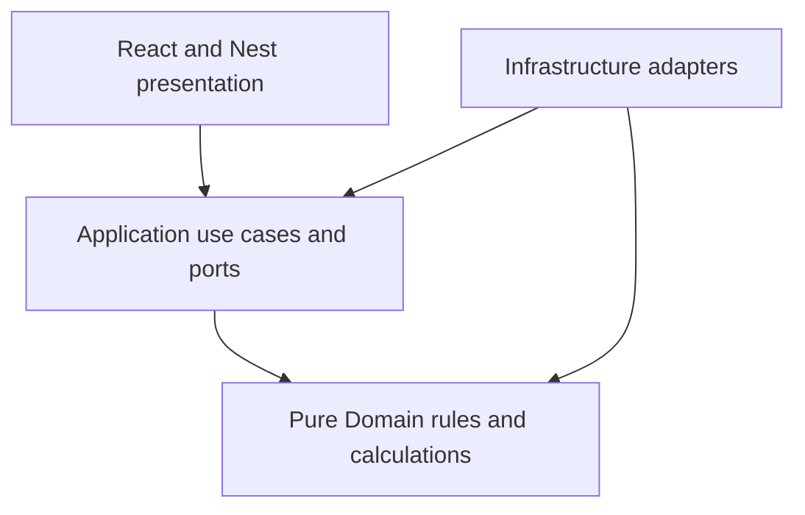

# Credit Copilot design

## Document assessment workflow

The supported fixture entry point is scripts/assess.ts and the eight-stage Mastra
adapter packages/infrastructure/src/workflows/document-assessment.ts. Application
stages live in packages/application/src/document-assessment.ts: local form schema,
protected-field stripping/local evidence facts, policy selection, verified model
extraction, exact required-clause retrieval, pure rules, canonical memo, pending
review persistence. The new input rejects client evidence/verifiedFacts properties.
No Mastra snapshot storage is configured; originals stay in the private case store.

The local CLI derives non-model facts from supported English evidence layouts;
unknown purpose, missing certificate/default evidence or contradictory employers
refer. Permanent employment alone does not prove probation completion. Required
policy clauses are loaded by edition/product/date from the active reviewed index;
missing clauses or DBR-source/config drift refer. Records include retrieved IDs,
executed/skipped/failed stage events, and provider usage even when returned JSON
later fails validation. Usage unavailable on transport failures remains unknown.
Saving failure fails the run rather than reporting success. No approval/offer is
issued. Internal legacy assessment helpers remain test harnesses; public transport
must use the document workflow and derive identity/synthetic status server-side.

## Versioned policy index

Clause chunking uses pinned cl100k_base tokenization (js-tiktoken1.0.21),800-token
maximum and60-token overlap only within oversized clauses. Small clauses/tables
stay intact. This tokenizer is a documented chunking budget, not Gemini usage.
Index migrations preserve legacy chunks and revision snapshots; a successful
transaction activates the new pipeline's chunks and deactivates previous ones.
Failures leave the old active index intact. Historical chunk IDs remain stored
for earlier citations. Changing bytes under the same reviewed document version
is rejected rather than silently replacing source evidence.

Numeric questions use a strict structured input contract through `pnpm calculate`.
The code chooses source-backed policy/pricing and returns calculation citations;
caller-supplied rates/DBR thresholds are rejected. Conversational number/date
extraction is not part of this baseline. Q&A returns exact source spans; the
explicit `text` alias accommodates observed provider JSON without trusting prose.

Implementation is incremental; README and status.md distinguish completed behavior from future work.

## Source-authoritative arithmetic

The pure decimal calculation engine receives thresholds from versioned policy configuration.
CP-2024 CP-4.1 sets maximum DBR50%; CP-2025 CP-4.1 sets45%. With net income30,000,
obligations4,000, annual rate24% and60 months, the inverse annuity formula yields
382,369.7534… at50% and330,228.4234… at45%. Floor to EGP1,000 gives382,000 and330,000.
Appendix E incorrectly labels the case CP-2025 while retaining382,000 from the50% example.
The engine does not special-case the example or modify the formula to match Appendix E.
Tests cover both editions using the same function. EMI rounds half-up to cents; DBR
is compared using the exact numerator against income multiplied by policy limit,
not the displayed rounded percentage. Policy configuration is reviewed source-backed
data, never a request-level override. Pricing must come from parsed CSV rows.

## Evidence modes

Configuration defaults to ASSESSMENT_MODE=strict and ALLOW_DEMO_MODE=false. Missing
national ID copy in Strict mode produces REFER_TO_HUMAN/MISSING_REQUIRED_EVIDENCE,
citing CP-8 and PS-7. Explicit enabled Demo is restricted to synthetic cases and can
assume only ID-copy presence. The result and audit events record the assumption,
actual missing evidence, actor/time and verified=false. No document is fabricated.
Other missing evidence, including probation confirmation, still requires referral.
Demo assessments are never presented as fully evidence-verified; changes of mode
require a new assessment, not relabeling an earlier result.

## Domain isolation

Assessment persistence follows dependency inversion: Application owns the repository
contract and Infrastructure implements it using TypeORM transactions. Run insertion,
audit, demo assumptions, successful extraction usage and fraud referral events commit
together. Duplicate run identifiers cannot overwrite prior records. The repository
checks the stored application preparer against the recording actor. Mastra can append
a separate persistence step; public authenticated transport and the complete stage
breakdown remain unfinished.

The internal assessment use case now parses an allowlisted form, resolves mode and
policy, verifies model extraction against evidence, selects supplied CSV pricing,
runs pure rules and produces a deterministic numeric memo. A typed Mastra adapter
currently wraps this use case as one workflow step. Persistence is an optional second step; it does not approve or issue offers. Evidence verification facts are trusted internal inputs and
must be derived server-side before exposing an assessment endpoint; client-supplied
verification flags must never be accepted. Separate typed workflow stages and
server-side evidence derivation remain required before the core gate.

Pure domain functions have no database, network, NestJS, Mastra or model imports.
ESLint enforces the infrastructure boundary. Dates use UTC calendar-only values and
month-end clamping; maturity is compared with the60th birthday. Strict configuration
validation prevents the string "false" from being treated as a true boolean.

## Architecture and source constraints

PostgreSQL knowledge/cases schemas and repositories separate trusted policy from
untrusted customer evidence. PDF/CSV/MD only, maximum10MiB/file and100 PDF pages;
no OCR. Clause/page/CSV-row provenance is retained; trusted source hashes live in
data/config/corpus-manifest.json. Documents at data/corpus are authoritative.
Provider prompts are files; Application generation/embed interfaces isolate Gemini.
A new provider implements ports in packages/infrastructure/src/llm and is selected
at the composition root (scripts/runtime.ts today; Nest composition later).

Application date selects half-open policy intervals; missing/ambiguous coverage
refers. CP2025 income10,000 overrides product's old8,000; PL-100 remains20,000–1m
and12–60 months despite circular72. Bureau score below600 refers, defaults decline,
verified hard eligibility failures decline; affordability follows eligibility.
Age at final maturity uses calendar dates, maximum60th birthday; minimum age21,
employment6 completed months, stamped salary evidence within60 days. Include all
bureau obligations/card minima; variable annual commission is not monthly salary.
Fees: admin1% deducted at disbursement, early settlement2% outstanding, late150EGP;
do not add them to regular principal/DBR without an applicable source rule.

Protected fields are removed locally before model/rules; model sees allowlisted
salary/bureau lines, not form names/IDs/phones. Verify labeled quotes and values,
not merely a number occurring somewhere. Tampering requires fraud referral. Human
approval must enforce authority0/250k/500k/1m and different preparer/approver; referred
approval requires Senior and written justification, exceptions Head approval, and
pricing deviations Credit Committee authorization. Records retained7 years; written
rejection reasons cite clause/edition and complaint requests have30-day window.
Historical pre-March2025 operational procedures are not supplied; do not invent them.

Remaining scope: complete typed eight-step workflow, server auth/approval/UI, full
15-case evaluation, then all nine stretches (hybrid BM25+pgvector/RRF, rewriting,
new synthetic documents, typed agents, SSE, local fallback, second product, offer
PDF/schedule, per-user usage/cost). PostgreSQL ts_rank is not BM25. Before hybrid,
retain vector baseline; compare actual results without assuming improvement.
