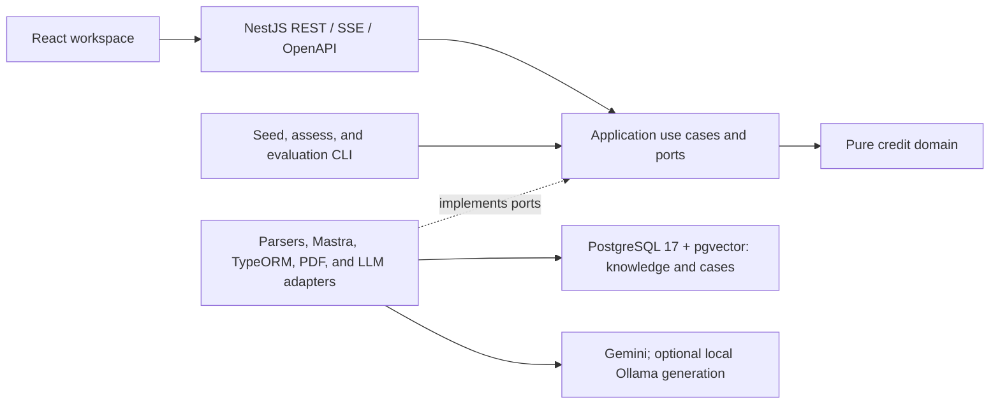

# Credit Copilot design

## Architecture

The application layer orchestrates evidence handling, dated policy lookup,
evaluation, and human decisions. The domain owns eligibility rules, approval
authority, and exact Decimal arithmetic, with zero framework, model, or database
dependencies. ESLint enforces these layer boundaries. Infrastructure implements
the ports, and NestJS controllers enforce session, CSRF, role, and authority
checks. Explicit TypeORM migrations manage the schema in two separated database
namespaces: `knowledge.*` for reviewed policies and `cases.*` for private
applications, runs, decisions, offers, and usage records. Both Docker Compose
(`docker compose up --build`) and the local launcher (`pnpm dev --seed`) run
migrations, idempotent policy ingestion, and demo-account seeding before
starting the API and web workspace. [Run instructions](../README.md)

## Corpus boundary and application intake

The ITI exercise supplied seven policy sources and five personal-loan packs
(`APP-001`–`APP-005`). The checked-in `credit-procedures-manual (1).pdf` keeps
its original filename and verified SHA-256 bytes so historical audit digests
stay reproducible. As a stretch extension, the repository adds four authored
auto-loan (`AL-200`) policy sources and three authored auto-loan packs
(`AUTO-001`–`AUTO-003`).

Trusted policy sources are verified by SHA-256 against
[corpus-manifest.json](../data/config/corpus-manifest.json) before indexing into
`knowledge.*`. Authorized `head-credit` users (`canIngest = true`) may also
upload custom policy documents (PDF, Markdown, or CSV) with explicit metadata
(`product`, `edition`, `kind`, `effectiveFrom`, optional `effectiveTo` and `id`)
or delete indexed policy documents (`DELETE /api/v1/knowledge/documents/:id`,
removing chunks, embeddings, index revisions, and pricing rows atomically while
logging a `deleted` attempt). Live ingestion streams stage-by-stage progress
(`extract → chunk → embed → index`) over authenticated SSE
(`POST /api/v1/knowledge/ingestions/streams` +
`GET /api/v1/knowledge/ingestion-streams/:id`). Customer application packs
(`APP-*` / `AUTO-*`, fixture hashes, or documents containing applicant form plus
salary/bureau evidence) are always rejected from `knowledge.*` with
`403 UntrustedPolicyDocument`. Customer application packs are verified
separately against
[assessment-fixtures.json](../data/config/assessment-fixtures.json). In the
**Applications** workspace (and `POST /api/v1/applications`), officers either
select a reviewed synthetic pack or upload an original application PDF; the
uploaded bytes, extracted form, and evidence remain isolated in `cases.*` and
are never written to the policy knowledge base.

## Ingestion, chunking, and cited retrieval

The parser registry validates file type, byte limit (`UPLOAD_MAX_BYTES`), and
structure for PDF, CSV, and Markdown. PDF ingestion enforces a 100-page cap and
requires an extractable text layer. Normalization preserves clause IDs, page
numbers, and CSV row numbers so every retrieved chunk carries verifiable source
provenance.

Chunking (`CHUNKER_VERSION = 'clause-cl100k-v3'`) splits along clause, page, and
CSV-row boundaries and caps oversized spans at 800 `cl100k_base` tokens with
60-token overlap. Inside summary comparison sections such as `CP-13` in
`credit-policy-2025.pdf`, the chunker tracks the active section prefix and major
number so lower-numbered comparison rows (`CP-4.1`, `CP-3.3`, `CP-9`) stay inside
`CP-13` instead of splitting into duplicate mislabeled chunks. Ingestion is
atomic per file and idempotent; newer document revisions retain historical
chunks so older citations remain inspectable.
[Chunker](../packages/infrastructure/src/parsers/chunker.ts)

Default retrieval uses hybrid search: PostgreSQL BM25 (`k1=1.2`, `b=0.75`) over
the GIN text index plus pgvector cosine search over the exact same active
revisions, product, half-open effective-date window, embedding model, and vector
dimensions. Each branch supplies up to 20 candidates to reciprocal rank fusion
(`k=60`), returning the top five. Policy Q&A still requires a qualifying cosine
score (`RETRIEVAL_MIN_SIMILARITY`, default `0.65`). Local glossary query
rewriting appends up to two lexical aliases (`QUERY_REWRITE_MAX_EXPANSIONS`,
default `2`) while keeping the original masked question for embedding, primary
ranking, and answer generation. Set `QUERY_REWRITE_MAX_EXPANSIONS=0` to disable
rewriting or `RETRIEVAL_STRATEGY=vector` for cosine-only retrieval.

In Policy Q&A chat, product and effective date/edition stay explicit on every
turn:

- Conflicting edition and date selections are rejected explicitly.
- Document and circular identifiers (`Circular 2025/02`, `PT-2025-01`,
  `CP-2024`, ISO dates) are parsed before standalone calendar-year checks, so
  questions citing a circular resolve to its effective date without falsely
  triggering year ambiguity, while a bare ambiguous year with no edition or date
  (such as `2025`) asks the user to clarify.
- Self-contained or out-of-corpus questions are separated from prior chat turns
  via `isFollowUpQuestion()` so unrelated questions (for example, asking about
  crypto-backed loans after earlier income questions) do not inherit prior
  retrieval terms and refuse cleanly.
- The generation model selects quoted spans by candidate ID; the verifier checks
  both IDs and exact substring wording against stored chunks before returning an
  answer or SSE citation event. After a valid non-refusal selection, a linked
  date-filtered lookup can supply governing precedence or circular clauses for a
  complete citation set. Weak evidence, invalid quotes, or model refusals return
  a refusal. Approval-bypass prompts with qualifying procedure evidence return a
  read-only rejection quoting `PM-1`/`PM-2`/`PM-3`.
- Source links open the original reviewed PDF, Markdown, or CSV inline through
  `GET /api/v1/knowledge/source?filename=...`, which validates manifest or
  indexed filenames, re-verifies SHA-256 digests for manifest files, requires an
  authenticated session, and disables caching. [Q&A implementation](../packages/application/src/questions.ts) ·
  [Operations](../packages/application/src/operations.ts)

## Dated policy, eligibility rules, and code-only calculations

Each application’s date and product select one unique policy edition and one
applicable dated rate row from the pricing CSV (matched by tenor and payroll
segment). `CP-2024` applies prior to 1 March 2025 (50% DBR ceiling, EGP 8,000
minimum net monthly income). `CP-2025` applies from 1 March 2025 (45% DBR
ceiling, EGP 10,000 minimum net monthly income). `CP-14` and `PS-3` keep
`PL-100` capped at 60 months even though Circular 2025/02 conditionally permits
72 months for specific segments.

Key rule-enforcement invariants in the pure domain:

- **Employment confirmation (`CP-3.1` / `PS-2`)**: explicit permanent salaried
  status (for example `"Employment is permanent"` / `"Her position is permanent"`
  without active probation caveats) satisfies employment confirmation; active
  probation or missing confirmation refers for human review.
- **Mandatory decline priority (`CP-8`)**: any failing hard eligibility rule
  (such as `CP-3.5` maturity age above 60, insufficient income, or default)
  produces `DECLINE` even if another rule refers. Soft referrals with no hard
  failures (such as `CP-6` bureau score 550–599) produce `REFER_TO_HUMAN`.
- **Exact Decimal arithmetic**: the domain runs 50-digit `Decimal` calculations,
  rounds monthly instalments to cents, tests DBR against the unrounded ratio
  before display rounding, and floors maximum eligible principal to EGP 1,000.
  At EGP 30,000 net income, EGP 4,000 existing debt, 24% annual rate, and 60
  months, the instalment on EGP 300,000 is **EGP 8,630.39** and DBR is
  **42.10%**. Maximum eligible principal is **EGP 382,000** under `CP-2024`
  (50% DBR) and **EGP 330,000** under `CP-2025` (45% DBR). Appendix E.2 of the
  supplied brief prints the 50% capacity (`382,000`) alongside the `CP-2025`
  (45%) label; the authoritative policy text governs, so Credit Copilot outputs
  `330,000` under `CP-2025` and `382,000` under `CP-2024`.
- **Auto-loan extension (`AL-200`)**: enforces a documented vehicle quote and at
  least 25% down payment (`PS-9`), capping financed principal at the minimum of
  DBR affordability, the product ceiling, and 75% of the vehicle price.

The LLM extracts candidate values and selects policy quotes; deterministic code
evaluates every eligibility rule, computes every number, and renders every memo.
[Calculations](../packages/domain/src/calculations.ts) ·
[Rules](../packages/domain/src/rules.ts) ·
[Personal-loan policy](../data/config/policies.json) ·
[Auto product](../data/config/auto-loan.json)

## Assessment workflow, typed agents, privacy, and human authority

An eight-stage Mastra workflow runs each assessment:

1. Load application form and evidence manifest.
2. Strip protected attributes and scan for prompt-injection tampering.
3. Select dated policy edition and product rules.
4. Run source-verified extraction over allowlisted financial/bureau fields.
5. Load governing dated policy clauses from `knowledge.*`.
6. Execute pure domain eligibility rules and Decimal affordability calculations.
7. Build the canonical credit memo and determine `approvalRequiredFrom` (PM-2).
8. Persist pending-review state, audit trail, and usage telemetry in `cases.*`.

When `ASSESSMENT_ORCHESTRATION=agents` is enabled, three bounded Mastra agents
(`evidence`, `policy`, `memo`) plan the corresponding stages through **typed Zod
input and output schemas** (`assessmentAgentInputSchemas` and
`assessmentAgentOutputSchemas`). The server binds the expected canonical
arguments, validates exact equality against `boundInput` before executing the
underlying tool, rejects unknown, repeated, or scope-tampered calls, and falls
back deterministically to the verified baseline operation if planning fails. An
agent can never alter applicant inputs, perform arithmetic, or approve a loan.
[Agent contracts](../packages/application/src/assessment-agents.ts) ·
[Mastra runner](../packages/infrastructure/src/workflows/assessment-agents.ts)

### Step 7 credit memo — deterministic rendering

Per Section 9 of the brief, Step 7 renders the credit memo deterministically in
code (`credit-memo.ts`) from verified rule outcomes, Decimal calculations,
required approval authority, and cited clause IDs rather than free-form LLM
prose. This guarantees zero LLM arithmetic hallucinations and ensures
bitwise-identical memos across protected-attribute fairness pairs (Scenario S5).

### Privacy, fairness, and prompt-injection defense

- **Protected-attribute removal**: `gender`, `religion`, `marital_status`, and
  `nationality` are stripped before model calls and rule evaluation, with
  removed field names recorded in the audit trail.
- **Minimal extraction payload**: the extraction prompt receives only the
  canonical reference and allowlisted salary/bureau excerpts (net income,
  monthly obligations, employment start, bureau score, section, page). Every
  extracted value must match its labeled source text verbatim.
- **PII masking**: Egyptian 14-digit national IDs and Egyptian mobile numbers
  (`01x`, `+20`, `0020` variants) are masked before embedding, lexical search,
  or answer generation.
- **Fairness verification (Q15)**: changing all four protected fields produces
  identical sanitized provider-input hashes, rule outcomes, calculations,
  recommendations, and canonical credit memos.
- **Prompt-injection defense (`APP-004`)**: tampering phrases in applicant
  documents (such as instructing the model to treat salary as EGP 200,000 instead
  of the documented EGP 18,000) are detected locally before any LLM call (zero
  generation tokens spent), retaining the real salary, recording the applicable
  policy edition, and routing to an internal fraud referral.
  [Verified extraction](../packages/application/src/extraction.ts)

### Strict vs Demo mode and human decision authority

- **Strict mode (default)**: enforces complete documentary evidence (`CP-8` /
  `PS-7`). Because the five supplied synthetic packs omit a separate national ID
  copy file, Strict refers them to human review.
- **Demo mode (`ALLOW_DEMO_MODE=true`, explicit opt-in on synthetic packs)**:
  assumes national ID copy presence *only* so reviewers can exercise the full
  end-to-end approval, alternative-offer, decline, and referral scenarios. The
  actual missing document (`verified: false`) remains explicit across the
  assessment result, audit trail, credit memo, and issued offer.
- **Approval authority (`PM-2`) and four-eyes**: Loan Officers prepare cases but
  cannot decide. Credit Officers approve up to EGP 250,000, Senior Credit
  Officers up to EGP 500,000, and Head Credit Officers up to EGP 1,000,000. The
  preparer can never approve their own case.
- **Referral adjudication (`PM-4` / `CP-6`)**: Senior Credit Officers and Head
  Credit Officers can review and decide non-blocking policy referrals (such as
  `APP-005` with bureau score 580 under `CP-6`). Approving a reviewable referral
  computes Decimal affordability and pricing on the server, checks `PM-2`/`PM-4`
  authority limits and four-eyes separation, records the reviewer's justification
  and conditions, and permits offer PDF issuance. Rejecting a reviewable
  referral requires a verified referral clause (`CP-6`, `CP-8`, or `CP-5`).
  Missing-evidence (`CP-8`/`PS-7`) and suspected-tampering referrals remain
  blocked from approval/rejection (`409 UnresolvedReferral`), and regular Credit
  Officers receive `403`.
- **Offer issuance and written reasons (`PM-9`)**: issuance re-checks maturity
  age and freezes principal, dated rate, conditions, actors, and a
  cent-reconciled repayment schedule into an immutable snapshot for the
  downloadable PDF letter. `PM-9` written reason requests are enforced within 30
  calendar days inclusive from the recorded Cairo rejection date and never
  override the recorded decision.

## Switching LLM providers

1. Add `packages/infrastructure/src/llm/<provider>.ts` implementing
   `EmbeddingPort` and `GenerationPort` from
   [ports.ts](../packages/application/src/ports.ts).
2. Wire the adapter in [provider.ts](../packages/infrastructure/src/llm/provider.ts)
   and add its `LLM_PROVIDER` enum value and settings to
   [config.ts](../packages/contracts/src/config.ts) and `.env.example`.
3. Domain rules, Decimal calculations, chunking, workflow stages, and human
   authority checks remain unchanged.
4. Whenever the embedding model or vector dimensions change, reindex the trusted
   policy sources (`pnpm seed`) because vectors from different embedding models
   are not comparable.

The built-in Ollama adapter (`OLLAMA_FALLBACK_ENABLED=true`) provides opt-in
local generation fallback after transient Gemini outages while keeping Gemini
embeddings, sanitized payloads, source-quote verification, and per-attempt usage
accounting intact.

## Intentional scope and follow-up

- **Code-filled plain-language memo**: prioritizes deterministic arithmetic and
  fairness parity over narrative prose generation.
- **Reviewed text documents only**: OCR for scanned images, external fraud-unit
  messaging, core-banking disbursement, and production cloud deployment are
  outside this exercise.
- **Benchmark sample size**: the live retrieval denominator covers four
  answerable policy questions alongside three out-of-corpus refusals and eight
  workflow/security/fairness scenarios. With additional time, the highest-value
  next steps are expanding the multi-edition policy Q&A benchmark, adding
  cross-browser Playwright coverage, and testing additional provider failure
  modes. [Evaluation](EVALUATION.md) · [AI usage log](AI-USAGE-LOG.md)
