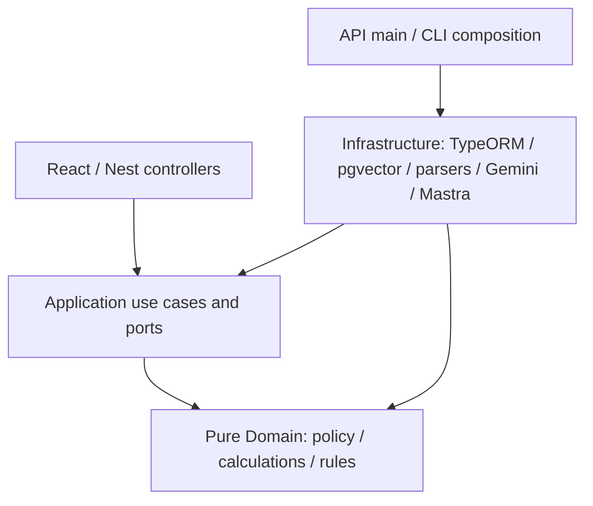

# Credit Copilot design

## Architecture and boundaries

Domain has no database, model, network, NestJS or vector-store imports; ESLint
checks the boundary. Application owns validation/orchestration and ports.
Infrastructure implements I/O. Nest controllers bind authenticated transport to
those use cases; React never supplies authority, evidence verification or synthetic
status. Evaluation orchestration belongs in scripts/evaluation/runner.ts, not the
production pipeline. PostgreSQL knowledge/cases schemas isolate trusted policy
from untrusted case evidence. synchronize=false; explicit TypeORM migrations only.
`pnpm dev` runs Compose health, the migration CLI and API/web processes; it retains
the DB on shutdown. It is a local launcher, not production hosting/deployment.

## Ingestion and retrieval

ParserRegistry dispatches PDF/CSV/MD only, checks extension/MIME/signature,10MiB
and100 PDF-page limits, then normalizes into a Zod-validated document schema.
Blank/encrypted/corrupt PDFs fail by name; no OCR is provided. Source text/page/
CSV-row provenance is retained. Seven policy files are SHA256-manifest trusted;
five synthetic application PDFs are hash-recognized but never indexed as policy.

Clause/page/row-aware chunks use cl100k_base, maximum800 tokens and60 overlap for
oversized spans. This is a stable budget tokenizer, not Gemini's exact tokenizer.
Index revisions retain historical chunks/citations; active revision/model/dimensions
and half-open effective dates filter search. Ingestion is atomic and idempotent;
one failed file is reported without claiming the entire batch succeeded.

Hybrid is the default policy search. PostgreSQL matches any distinct English
query lexeme against the existing GIN-indexed `tsvector`. Lexeme positions give
term frequencies and chunk lengths. BM25 uses k1=1.2 and b=0.75, with document
frequency and mean length computed over the eligible chunks. Both branches share
the active revision, product, effective date, embedding model and dimensions.
[PostgreSQL 17 text search functions](https://www.postgresql.org/docs/17/functions-textsearch.html)

Each branch contributes up to 20 results. Reciprocal rank fusion adds
`1 / (60 + rank)` per branch in which the chunk appears, deduplicates by chunk ID
and returns the top five with ties settled by chunk ID. Q&A still requires an
actual cosine similarity of at least 0.65 by default, including for candidates
found only by BM25. Set `RETRIEVAL_STRATEGY=vector` for the cosine-only baseline.
The existing indexes and ingestion pipeline support both modes.

Hybrid Q&A also supports deterministic query rewriting. A fixed glossary appends
up to two equivalent search phrases by default. The original masked question
drives the embedding, original hybrid rank, source lookup and evidence prompt.
PostgreSQL scores the two lexical variants within one database snapshot using
the same product, effective date, active revisions and vector. The alternate
can replace an original candidate below the cosine floor only with a different
candidate that clears the floor. Qualified original hits keep their slots.
The original search handles unsupported aliases, disabled budgets and approval
bypass requests. Set `QUERY_REWRITE_MAX_EXPANSIONS` between 0 and 4. Zero runs the
plain hybrid search. A rewrite adds no provider calls.

With a qualifying primary hit, a separate date- and product-filtered lookup can
load the operative income, tenor or approval procedure clauses. It takes the
operative clauses before annex comparison rows. Relevant approval bypass
requests receive the dated procedure excerpts and an explicit rejection of the
requested action.

Generation receives source metadata and exact evidence, chooses quoted spans,
and the verifier rejects unknown IDs/changed words/numbers (whitespace folding and
explicit text→quote alias only). After a valid non-refusal selection, the answer
includes the associated canonical verbatim references so conflicts are not shown
one-sidedly. Weak primary search, invalid model output or model refusal still
refuse. The read-only approval response also requires qualifying procedure
evidence. The interface deliberately
returns evidence excerpts rather than unrestricted model prose. Date/edition
selectors and explicit question references must agree; default is today's Cairo
calendar date. Numeric calculations use the structured calculator, never an LLM.

## Source authority and arithmetic

Application date selects a unique policy edition. CP-2024 applies50% DBR/minimum
income8000; CP-2025 applies45%/10000 from2025-03-01. PL-100 stays20000–1000000 and
12–60 months even though Circular2025/02 conditionally allows72. CP-14/PS-3 require
the stricter product cap; cite both sides. Pricing selects latest applicable CSV
row by date, tenor and payroll-transfer segment. Policy/pricing values never come
from the caller. Unsupported/ambiguous dates or rows fail/referral explicitly.

Decimal uses isolated50-digit precision; EMI rounds half up to cents. DBR compares
exact instalment/obligation values before display rounding; capacity floors to1000.
One unchanged formula yields EMI8630.39 and max382000 under50% or330000 under45%
for income30000/debts4000/rate24%/60 months. Appendix E incorrectly labels the50%
capacity as CP-2025. The actual source policy wins; no example-specific hardcode.
Eligibility precedes affordability: employment6 completed months, confirmed
probation, net income, age>=21, final maturity no later than60th birthday, bureau
score>=600, no default, permitted purpose, salary certificate/stamp within60 days.
Unknown evidence refers. Below600 refers rather than auto-declines. Product bounds
are checked. Admin1%, early settlement2% and late150EGP are not silently added to
principal/DBR without an applicable source rule. Dates clamp calendar month-end.

## Assessment, evidence and privacy

The supported Mastra adapter executes eight typed stages: load form, locally
remove protected fields/derive evidence facts, select policy, verified extraction,
retrieve applicable clauses, code rules/calculations, code memo, transactional
pending-review persistence. Tampering skips model/rules but still records policy
when a valid form date exists. Missing clauses or source/config drift refer.
Original packs have no ID copy: Strict is default and refers under CP-8/PS-7.
Explicit enabled synthetic Demo assumes ID presence only, records actual missing
reality/actor/time/verified=false in result/audit/offer/reply, and fabricates no ID.
Permanent employment alone is not completed probation; APP-002/003/005 continue to
refer even in Demo. Original pack financial-only/rule evaluations must be labeled
separately from whole-application recommendations; no fixture is silently completed.

Raw forms and protected gender/religion/marital-status/nationality values stay out
of model/rule input. The model sees only allowlisted salary/bureau labels and source
provenance, no names/IDs/phones; quoted values are verified against their exact
labeled source field. Q&A masks14-digit ID/Egyptian phones, not arbitrary PII; do
not put customer profiles into questions. Injection in customer evidence has no
authority; APP-004's18000 cannot become injected200000. Fraud routing is recorded
internally, not claimed externally delivered. React renders text, never model HTML.

Each persisted run records request/actor IDs, stage statuses, retrieved chunk IDs,
policy edition, removed-field names and reported token usage. Invalid JSON retains
available usage; unreported usage is null/unknown, never invented zero. Code-filled
plain memos include mode, evidence, source rules, CSV rate provenance and computed
numbers, including a safe summary for referrals. No model generates lending numbers.
Fairness pairs compare sanitized-provider-input hashes, rules, calculations,
recommendation and canonical memo after only protected attributes change.

## Sessions, human decisions and case review

Server sessions are random32-byte tokens stored only as SHA256 digests; passwords
are scrypt hashed. HttpOnly/SameSite Strict cookies, CSRF/origin checks, expiry/
revocation, active-user checks and atomic per-IP login throttle apply. No public
registration/role-upgrade endpoint. Loan Officer authority0; Credit250k, Senior500k,
Head1m. Different preparer/approver, current version/latest run, complete eligibility
and customer alternative acceptance precede approval. Only stored human approval
can issue, with a source-policy maturity recheck. Demo is never relabeled verified.

Application locks bind one running assessment and idempotency key/mode. Retry
replays its immutable result; failed attempts need a new key. New attempts expire
abandoned15-minute jobs and reject late writes. Decisions wait for reassessment;
issued applications cannot be reassessed. Assessment result/latest pointer/audit/
usage commit together; queue omits superseded runs. No waiver or pricing exception
endpoint is provided. Originals and decisions/approver identity remain in private
case storage with seven-year retention metadata.

Senior/Head handle referrals, with independent written evidence/reassessment/fraud
notes that never clear missing evidence or change eligibility. Standard Credit
queues omit referrals. PM-4's two-business-day target is indicative, using the
configured Fri/Sat/default holiday list; no public holidays are invented. Verified
failed clauses or a customer-declined alternative support rejection; missing
ID/fraud/bureau-only referral does not. A notice snapshots failed criterion, human
justification, applied clause, original edition/source and decision time.

PM-9 requests a written reason, not an appeal outcome. The preparer records the
applicant request within30 inclusive calendar days of the recorded Cairo rejection
date (documented interpretation: no separate notification timestamp supplied).
Locked concurrent retries return one stored deterministic written reply/audit pair,
without changing credit status/version; replies remain readable after expiry.
Legacy history is backfilled only from recorded clause/edition; missing history
requires human review instead of a fabricated response.

## Provider, evaluation and intentional limits

The API and CLI use a shared provider factory. Gemini owns document and query
embeddings. When local fallback is enabled, exhausted Gemini retries for HTTP
408, 429, 5xx and transport failures can trigger one Ollama generation request.
The primary error is returned for configuration, credentials or validation
problems. An embedding outage returns a service failure before vector search.

Ollama receives the same sanitized input and a JSON schema derived from the
application validator through loopback HTTP with redirects disabled. Compose
disables Ollama Cloud. Model replies still pass the source quote and extracted
value checks. For citations, its schema pairs each allowed chunk ID with exact
source spans and permits an empty selection. The assessment workflow records the
failed Gemini logical call
with unknown usage, the Ollama model and its reported counts, and a fallback
event. Q&A includes local generation attribution in the answer or refusal when
it receives a model completion. The memo remains code-generated.
[Ollama structured output API](https://docs.ollama.com/capabilities/structured-outputs)

The frozen fifteen-case live baseline and failed first run are committed as JSON;
EVALUATION.md defines denominators, source-context distinction and limitations.
Offline CI uses deterministic source/provider fixtures, explicitly not measured
semantic quality. Live runs use isolated *_eval DBs, known source-vector reuse and
fresh query/generation calls. No raw credentials/customer forms are exported.

Plain memo wording is an intentional acceptable cut, not missing calculations.
All nine stretches still follow the passing functional core gate. Final submission
video, interactive clean-clone review and the missing fourth actual commit date
remain explicit readiness gaps; the measured functional gate does not certify
those deliverables. No paid-provider cost, general quality or deployment is claimed.
