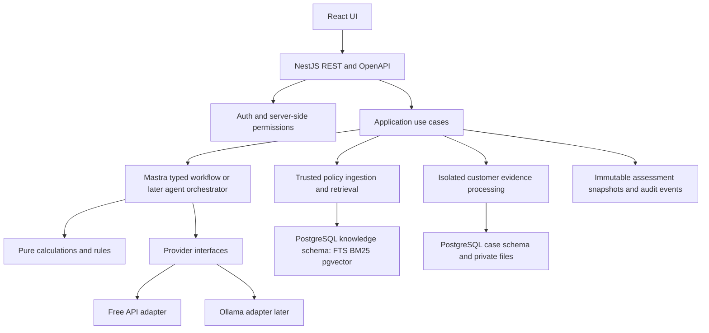

# Credit Copilot implementation plan

Status: planning only. User decisions are fixed; architectural choices below are proposed defaults. Pending decisions are in README.md. No dependency installation, application implementation, infrastructure creation, or repository publication is authorized by this plan itself.

## Outcome and scope

An English-language synthetic underwriting assistant for PL-100: ingest policy documents, answer with verifiable citations or refuse, assess five application packs, compute exact values in pure functions, prepare a recommendation, and require an authorized different human before issuance. React is the required interface; the brief permits UI OR CLI, so a second interactive CLI is unnecessary. Documented seed/evaluation commands still exist.

All nine stretches follow a successful core release: hybrid RRF; query rewriting; new synthetic corpus/tests; 2–3 typed tool-calling agents; SSE; local fallback; auto-loan product; approved letter PDF and schedule; per-user token/cost tracking. No autonomous approval or LLM arithmetic at either stage.

## Architecture and ownership

Proposed TypeScript pnpm workspace: apps/web, apps/api; packages/domain, contracts, application, infrastructure, evaluation. Keep abstractions small; domain imports no NestJS, ORM, Mastra, provider SDK, network or vector library. Nest controllers call use cases; Mastra is an orchestration adapter, not a second public server. React calls REST; client code never calls models or database directly. TypeORM migrations own all application schemas with synchronize disabled. Any Mastra persistence must share explicitly migrated tables or use our run repository; no hidden runtime DDL.

Core deterministic stages use Mastra createStep/createWorkflow with validated boundaries. `GenerationPort.completeStructured` and `EmbeddingPort.embed` isolate external providers. One adapter module can implement both. Proposed adapter locations: packages/infrastructure/src/llm/providers/<provider>.adapter.ts and provider registry; configuration chooses adapter/models. Changing provider requires new adapter plus config/registry registration, no domain/pipeline changes. Fake adapter supplies offline tests. Prompts live in versioned prompt files.

PostgreSQL with pgvector in Docker Compose, plus API and web. Use dedicated schema namespaces and access repositories: knowledge cannot query customer evidence. Distinct trusted-ingestion and evidence-upload routes; changing a filename or content label cannot promote evidence into the knowledge base. A server-side ingest permission is assigned to a seeded officer; arbitrary uploads never become trusted automatically. Store immutable source files in separate private mounted directories, never web public paths.

## Proposed model configuration for the reported hardware

User reports16GB RAM and4GB graphics memory; GPU model/support is unknown. Proposed cloud generation `gemini-3.5-flash-lite`, text embedding `gemini-embedding-001` with768 output dimensions and explicit unit normalization. Confirm exact model access, dimensionality and free quota by a smoke test during implementation; provider selection/API-key availability is still the final user decision. Use document/query retrieval task types consistently. No model downloads or API calls with applicant data have occurred in planning.

For the local stretch, propose Ollama `qwen3:1.7b` Q4_K_M, with modest4096-token context, one active request, bounded output and no assumption of full GPU offload. Its published download is1.4GB; runtime RAM/VRAM use is larger and must be measured. Local embedding `nomic-embed-text:v1.5` uses a separate full-corpus index, built before marking fallback ready; pin model digest and actual dimension. Respect its model-specific input prefix/token limit. Never compare cloud query vectors to local chunk vectors even if dimensions happen to match. Run generation and embedding sequentially if memory pressure requires it. Recalibrate retrieval threshold for each embedding model and label local evaluation separately.

References checked17 November2026: [Gemini pricing and free-tier model access](https://aistudio.google.com/docs/pricing#gemini-3.5-flash-lite), [text embeddings](https://aistudio.google.com/docs/embeddings), [Qwen local model](https://ollama.com/library/qwen3:1.7b), [local embedding model](https://ollama.com/library/nomic-embed-text). Free-tier quotas are account-specific; synthetic sanitized text only. No paid plan is assumed.

## Parser layer and ingestion

Proposed parser libraries to verify/pin at implementation: pdfjs-dist for PDF text items with page and coordinates, csv-parse for CSV, unified/remark-parse for Markdown AST. Registry interface accepts bytes and declared media type, returns document blocks with original text and locators. Supported extensions: .pdf, .csv, .md only, case normalized. DOCX brief is a development reference and remains unsupported as a user upload.

Stages, separately testable:

1. Validate extension, filename, actual content/MIME consistency, non-empty bytes and limits. Proposed 10 MiB/file, 100 PDF pages, 20 files/batch, extraction timeout 30s; configuration documented. Markdown/CSV have no reliable magic bytes: verify UTF-8 and parse structure instead. Reject binary masquerading as text, encrypted PDFs, malformed CSV and path traversal. No OCR required: scan-only PDF reports TextLayerMissing.
2. Extract locally; preserve page boundaries, table headers, row identity, clause headings and parts. Salary table crossing APP-001 pages must remain traceable. PDF page splitting must not lose net income.
3. Normalize Unicode/whitespace and numeric/date text conservatively, strip repeated page headers only with provenance. Preserve original text, normalized text, offset mapping, pageStart/pageEnd, section/clause and CSV row. Never remove source meaning or run document instructions.
4. Validate NormalizedDocument schema: id/hash, source kind, trust classification from route, product, version, effective dates, parser/version, ordered blocks, warnings. Invalid metadata is rejected or placed in review, not guessed by model.
5. Chunk by clause/subclause; preserve tables with their headers. Proposed target 300–600 tokens, hard ceiling 800; split oversized clauses by paragraph/sentence with up to 60-token overlap inside same clause. Small related blocks can share a chunk only within same section, edition and effective interval. Pricing rows become complete row chunks with column names; PM-2 table remains a complete unit.
6. Embed only trusted policy chunks in core. Cache by normalized text hash plus embedding model/version/dimension. Persist vectors only with model metadata; never mix incompatible vector spaces.
7. Index under a staged ingestion revision, then atomically mark it searchable when parsing, chunks, pricing extraction and embeddings succeed. Per-document transaction boundary; batch can partially succeed with explicit per-file results. Failed documents do not leak partial new chunks into search.

Idempotency: source hash + logical document id/version + parser/normalizer/chunker version; chunk deterministic ordinal/hash; database unique constraints handle simultaneous retries. Reingesting identical document/pipeline skips; pipeline change builds replacement revision, preserving old citations. Same document/version with different bytes raises DocumentVersionConflict unless explicit revision workflow. Expired policies remain retained for historical queries.

Separate evidence flow reuses parsing/normalization, never policy index. Parse form locally, validate amount/tenor/DOB/application date; identify salary and bureau sections. Store originals restricted, sanitized derived text separately. Audit provenance for each field includes source id/page/section, raw quote and normalized value. Do not persist protected values in assessment records.

## Privacy and malicious evidence

Remove gender, religion, marital status and nationality before ANY model call, embedding, rule check or generated prompt. Mask national IDs and phones before provider calls. Because names/titles/pronouns can leak attributes and destabilize fairness, model context uses neutral applicant identifier and field-focused salary/bureau excerpts; names/contact stay in authorized identity view and code-filled letter only. Reject/safely refer if sanitizer cannot reliably isolate supported fields. Keep a redaction mapping locally for quote validation, never send it to provider.

Raw originals remain restricted for PM-8 retention. Model tools, logs, traces and policy retrieval cannot read them. Log removed field names, not values. Verify sanitization on all model-facing paths including retries, fallback, query rewriting, memos and agent tools.

Applicant text is data in a clearly delimited field, never prompt instructions. Disable model network/file/code tools. Suspicious instruction detection raises a tampering flag and Fraud Unit event but keyword detection is not the security boundary. Verify each extraction quote exists in the identified sanitized source section, then value exists in its proper labeled field; a match anywhere is insufficient. The injected 200,000 in APP-004 exists in text but is not salary-table evidence. Code retains 18,000 where verifiable, flags tampering, and refers regardless of otherwise passing financials.

## Versioning and retrieval

Date resolution is code: explicit application date wins; explicit edition/date in Q&A must agree or request clarification. For unspecified current questions, select current applicable known version and display as-of date. Historical operational questions with missing manual/product coverage refuse. Use half-open intervals and product filters before candidate ranking in BOTH search branches. Active circular references may pull explicitly incorporated historical clauses, labeled as carried-forward evidence, without treating the whole expired circular as active.

Rules are versioned typed configuration transcribed from trusted clauses and reviewed against source citations. The LLM must not invent thresholds. Retrieval supplies explanations and citations; deterministic rule configuration selects actual thresholds. Missing required clause or mismatched rule snapshot => refer even when a nearby semantic hit looks plausible. Unknown newly uploaded policy is searchable only after trust validation and is not executable lending policy until rule mapping is reviewed.

Core baseline: exact cosine search with pgvector, top 20 candidates, top 5 final evidence. Tiny corpus favors exact filtered ranking; HNSW is a later scale option, not necessary now. Query embeddings use same model as indexed corpus. Record candidate scores and ids for evaluation.

Hybrid after core gate: PostgreSQL FTS English lexemes and GIN candidate matching; actual BM25 score from persisted per-chunk term frequencies and document lengths plus corpus statistics. Tokenize query and documents consistently; OR-match all eligible query terms, no pre-truncation that might discard the best BM25 candidates. Recompute document frequency/average length over the same eligible version/product corpus (or explicitly consistent corpus partition) and include all eligible zero-match chunks in corpus size/average. Small corpus permits exact SQL computation. Proposed k1=1.2, b=0.75; IDF=ln(1+(N-df+0.5)/(df+0.5)); sum contributions per distinct query term. Deduplicate by chunk id and tie-break by stable id. FTS positional limits must not silently truncate counts; use normalized token/posting tables for reliable BM25 tf/dl.

No claim that ts_rank is BM25. Proposed portable SQL BM25 avoids another extension; a pinned pg_textsearch image is an alternative only after explicit architecture revision and compatibility check.

RRF combines top 20 BM25 and top 20 vector: score=sum(1/(60+rank)), ranks start at 1, equal weights, missing branch contributes zero. Final top 5 for evidence, optionally expanded with same-clause parent context inside token budget. Do not combine raw incomparable cosine/BM25 scores.

Refusal cannot depend solely on RRF score: it encodes rank, not absolute relevance. Calibrate cosine floor/lexical evidence criteria using separate calibration cases; validate every answer claim against allowed chunk ids. No supported context => exact refusal text. Display citations with filename, edition, effective dates, clause, page or row, chunk id, quote. Unknown chunk id, fabricated quote or unsupported numeric claim => reject generated answer/fallback grounded template. Conflicts require both sources and deterministic precedence explanation. Core question arithmetic routes to the same calculator; model must not calculate user-requested ratios.

## Assessment pipeline

1. Load/schema-validate application form and completeness.
2. Strip protected attributes and mask identifiers locally; persist audit names.
3. Resolve policy/product/circular editions in code.
4. Model extracts typed income, obligations, employment start and score, plus supporting evidence and required status fields; validate schema and provenance. Future dates, inconsistent totals, missing/default/confirmed-employment evidence => named referral.
5. Retrieve required applicable clauses; load typed rules and CSV pricing; verify citation/rule snapshot agreement.
6. Run pure eligibility first. Verified hard fail => decline recommendation; score below floor/missing/tampered evidence => refer. Only eligible cases proceed to affordability and permitted alternate principal. Unsupported or competing rules go to human, no guessed precedence.
7. Produce memo from typed rule results: LLM selects qualitative explanation and allowed citation ids; numbers represented by approved placeholders, inserted by code. Reject arbitrary generated numbers. Deterministic canonical summary is the fallback and basis for identical fairness outputs.
8. Save immutable recommendation, pending human action. Separate approval service enforces all invariants. Failure at any assessment stage becomes referral with diagnostic record; invalid upload/request before assessment gets clear 4xx rather than fabricated assessment.

Recommendation enums: approve, offer_alternative, decline, refer. Lifecycle independent: submitted, assessing, pending_approval/pending_review/pending_customer_acceptance, approved, rejected, issued. UI shows business recommendation separately from workflow status. DBR failure alone cannot become final rejection before alternative handling; explicit customer acceptance/rejection is recorded, not assumed.

## Calculations and decision semantics

Confirmed decision (17 November 2026): the applicable policy edition is authoritative. Versioned, source-cited rule configuration supplies DBR 0.50 for CP-2024 and 0.45 for CP-2025 to the same pure calculation function. For income 30,000, obligations 4,000, annual rate 24% and tenor 60 months, maximum eligible principal is respectively 382,000 and 330,000 after flooring to EGP 1,000. Appendix E incorrectly combines the CP-2025 label with the 50% result. Never hardcode these outputs, alter the formula, or expose an arbitrary per-request DBR override. Configuration changes require a reviewed rule version with source provenance; record the selected version/limit in each assessment. Both edition regression tests and the discrepancy explanation are required in the eventual docs/DESIGN.md and docs/EVALUATION.md, with actual test results recorded only after execution.

## Strict and Demo evidence modes

Confirmed decision: Strict is the default. Proposed server configuration: ASSESSMENT_MODE=strict and ALLOW_DEMO_MODE=false. Missing configuration resolves to strict; invalid configuration fails validation. Explicit demo selection requires the server demo flag and a synthetic case; it cannot be activated by document text or an LLM response. Persist the resolved mode and configuration version in the assessment snapshot.

When the required national ID copy is absent in Strict mode, return recommendation REFER_TO_HUMAN with reason MISSING_REQUIRED_EVIDENCE, missing item national_id_copy, and citations CP-8 and PS-7. This is a business result, not an automatic decline or an unhandled exception. The lowercase recommendation label `refer` elsewhere in this plan is conceptual shorthand; the external referral enum is REFER_TO_HUMAN.

Demo mode may assume only that the national ID copy is present for workflow demonstration. Record an explicit assumption in both assessment result and audit log: requirement national_id_copy; actual evidence missing; assumed present for demo; verified false; actor, timestamp and reason. Do not create an evidence document, invent a source quote or verifier, mark the actual evidence verified, or silently alter the requirement. All other policy and evidence rules remain active. Earlier proposals to assume completed probation are withdrawn: unclear confirmation evidence remains a referral or requires real supporting synthetic evidence separately identified from the original pack.

Results, UI, exports and any simulated offer must display demo status and assumptions. Keep actual evidence-completeness and verification status separate from mode; a demo run cannot claim fully verified evidence. Switching to Strict requires a new assessment against actual documents; no in-place relabeling of an earlier demo approval. Approval authority and four-eyes controls apply in both modes. Demo assumption never changes DBR, pricing, arithmetic or eligibility rules.

Required tests: omitted/default mode, strict missing-ID referral with both citations, explicit enabled demo with assumption in result and audit, disabled-demo rejection, no fabricated document/verification, other missing evidence still referring, and unchanged policy calculations across modes. Document configuration and operational distinction in README, DESIGN.md and EVALUATION.md. Tests and documentation here are planned deliverables, not completed implementation.

## Calculation implementation contract

Use a decimal library with fixed rounding policy; money serialized as decimal strings, integer months, ISO date-only values. No JavaScript floating rounding for money. Monthly r=annualPercent/100/12; EMI=P*r/(1-(1+r)^(-n)), zero-rate branch P/n. EMI rounded half-up cents. DBR=(obligations+rounded contractual EMI)/income compared without display rounding; display percent to two decimals. Preserve numerator/denominator or sufficient decimal precision for exact comparison by cross multiplication.

Affordable instalment cap=max(0,income*DBRlimit-obligations). Invert EMI, floor principal to 1,000, apply product max, then recompute contractual EMI/DBR; ensure chosen 1,000 step passes and next allowed step fails or hits product max. If below product minimum, no valid counteroffer. Expose affordability capacity separately from recommended amount; do not increase request automatically. Annual rate comes only from effective CSV segment/tenor match, never source-code constant. Salary transfer is evidenced field, not inferred from employer name.

Dates use calendar month arithmetic with documented end-of-month clamping; employment minimum uses whole completed months. Planned final due date=planned disbursement+n months. Recheck if timing changes. No numeric outputs from LLM. Rates, dates, fees, schedules, authority limits and totals are inserted from trusted structured data.

## Persistence contracts

| Entity group | Required data/invariants |
|---|---|
| users, sessions | hashed password, RBAC role, authority tier, active status; server-owned assignment |
| policy_documents, revisions, blocks, chunks | hashes, parser versions, effective interval, product, clause/page/row provenance, trusted status |
| chunk_embeddings, term_postings, corpus_statistics | model id/dimension, unique chunk/model revision; consistent lexical statistics |
| policy_rule_sets, pricing_rows | rule/version/citations, decimal rates and thresholds, non-overlapping effective bands |
| applications, evidence_documents | restricted originals and sanitized derived evidence; owner/preparer; no protected fields in assessment input |
| assessment_runs, extracted_fields, rule_results | immutable input/rule/model/prompt versions, quotes, calculations, recommendation and retrieved ids |
| approvals, customer_responses, offers | approver/time/comment, assessment version, accepted amount, schedule, idempotency |
| audit_events, fraud_referrals, complaints | request/run/user ids, step events, removal names, written reasons, retention timestamp |
| llm_usage, evaluation_runs | token counts/model/user/pricing snapshot, actual or unavailable usage; frozen eval configuration/results |

Transactions lock assessment status and validate version during approval; unique offer per approved assessment; idempotency keys prevent duplicate approve/issue. Reassessment makes prior pending recommendation stale. Old final records remain immutable. Seven-year retention metadata covers originals and outputs; deployment backup procedure documented. Demo DB reset is explicitly separate from production-retention semantics.

## REST and UI contract

All versioned under /api/v1; OpenAPI request/response/error schemas. Proposed routes:

- POST /auth/login, POST /auth/logout, GET /auth/me.
- POST /knowledge/ingestions, GET /knowledge/ingestions/:id, GET /knowledge/documents; trusted ingestion permission required.
- POST /questions with question, optional asOfDate/edition/product; returns answer/citations/refusal/requestId.
- POST /applications (multipart pack + structured metadata), GET /applications, GET /applications/:id.
- POST /applications/:id/assessments; GET /assessments/:id (results, evidence, calculation, audit).
- POST /assessments/:id/customer-response; POST /assessments/:id/approve or /reject with comment and expectedVersion.
- POST /assessments/:id/issue with planned disbursement date, requiring valid approval and revalidation; GET /offers/:id.
- GET /reviews and /fraud-referrals; POST /applications/:id/complaints; GET /applications/:id/decision-reason.
- Stretch GET /runs/:id/events, GET /offers/:id/letter, GET /usage/me.

Login: proposed same-origin HttpOnly secure session cookie, CSRF protection on mutations, no localStorage credential, password hash and rate limiting. Demo users use env-seeded passwords; only synthetic data. Loan Officer ask/submit/view owned files; Credit Officer review/approve within tier and scope. Every evidence download checks authorization. No role taken from request body.

React minimal screens: login; document ingest/status; policy Q&A with date/edition/product selectors and expandable citations; pack select/upload; assessment detail with progress, verified fields, rules, calculations, memo, audit; review queue with amount/authority and comment actions; issued offer. Add usage panel and auto-loan fields only in stretches. Standard accessible controls, loading/error/referral states; no elaborate visual redesign. Clarify source conflict and stale approval in UI. Do not expose raw protected values or render model HTML.

## Error taxonomy

| Failure | API handling / business handling |
|---|---|
| UnsupportedFileType, FileTypeMismatch | 415, file-specific message |
| FileTooLarge | 413 |
| ExtractionFailed, TextLayerMissing, EncryptedDocument, InvalidNormalizedDocument | 422 ingest failure; assessment evidence => refer |
| InvalidApplication, InvalidCSV, InvalidDate | 422 validation details |
| PolicyEditionNotFound, AmbiguousPolicyEdition, PricingNotFound | 422 or saved referral if run exists |
| InvalidLLMOutput, UnverifiedExtraction, EvidenceConflict, SuspectedTampering | persisted referral; tampering also Fraud Unit event |
| ProviderUnavailable, EmbeddingFailure | bounded retries for transient failure; clear unavailable/failed job; run referral |
| Unauthenticated, Forbidden, AuthorityLimitExceeded, FourEyesViolation | 401/403; no status mutation |
| InvalidTransition, StaleAssessment, DocumentVersionConflict | 409 |
| Unknown internal fault | sanitized 500 + requestId, audit safe diagnostic; never leak secrets or auto-issue |

Retries proposed at most two exponential-backoff attempts with jitter for transient network/429; never retry irreversible side effects without idempotency. Persist every attempt usage. No quiet change to embedding model on provider failure.

## Stretch details and boundaries

1. Hybrid as specified; compare same dataset/config vector vs hybrid, record actual gains or regressions.
2. Choose query rewriting (the brief says re-ranking OR rewriting): typed policy-query rewrite preserving product/date/amount intent; retrieve both original/rewrite with bounded candidates; benchmark against hybrid alone. No rewrite of customer evidence into trusted instructions.
3. New synthetic documents: dedicated supplemental corpus with unique ids/effective dates, new cases; originals untouched. Test contradictory/expired docs and refusal.
4. Three Mastra agents: evidence extraction, policy research, memo composition; typed allowlisted tools. Agent orchestration can choose permitted retrieval/extraction calls but deterministic lifecycle gates enforce ordering, privacy, policy selection, maths and approval. Keep core fixed workflow as baseline/test oracle. Agent mode becomes default only after parity tests; it must actually use tool calling, not merely rename fixed steps.
5. SSE emits request/run-scoped step events and streaming Q&A; authenticate reconnection and event sequence. Stream only validated grounded answer segments; never leak unvalidated model tokens or protected evidence. Terminal failure and cancellation documented.
6. Ollama generation fallback on exhausted retries/quotas, schema validation and same privacy controls. Proposed hardware-sized models are listed above. Prebuild a separate local embedding index for the complete trusted corpus and activate it only when complete; cloud and local spaces never mix. If no complete compatible index is ready, fail/refuse safely. Record fallback model and actual usage availability.
7. Synthetic auto loan with explicit product sheet/rules/pricing, minimum down payment and vehicle price evidence. Proposed fixture terms require final planning approval before authoring: same applicant eligibility, 20% minimum down payment, financed amount=vehicle price-down payment, 12–60 months, 20,000–1,000,000 principal, rates in separate CSV. Clearly invented training product, not silently applied PL-100 terms. Include pass/down-payment fail/missing evidence/cross-product isolation tests.
8. Choose PDF offer letter (brief allows PDF OR DOCX). Issued offers only; all amounts, fees, net disbursement, dates, amortization schedule filled by code. Deterministic rounded schedule adjusts final payment to close residual balance; principal sum equals loan, final balance zero. Authenticated download and no client-forged approval.
9. Token/cost tracking by user/run/model: provider-reported tokens, cache/retries/fallback flagged; model-price snapshot, currency and free-tier cost 0 distinguished from estimated list cost. Missing usage => unknown, not zero. Do not make up local token counts.

## Completion and handover

Core gate: all FRs, all five source packs assessable in agreed mode, tests green without internet, real provider smoke, real vector baseline evaluation, replayable demo and server approval controls. Only then begin stretch PRs. Final gate: all nine stretches individually demonstrated and measured where required, real CI green, fresh clone, secret history scan, docs and video. Nothing is marked implemented or tested until execution evidence exists. Four-day effort estimate and constraints are in PR-PLAN.
